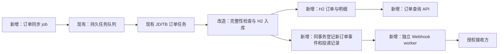

# 订单 H2 存储、后台同步与新订单 Webhook 计划

日期：2026-10-23（Asia/Singapore）  
状态：计划，尚未修改业务代码、数据库或远端配置。

## 1. 确定的目标

1. **调用方查询订单直接读 H2，不等待浏览器抓取，也不依赖调用方发起订单任务。**
2. 服务启动后台订单同步 job，定时复用现有 JD/TB 订单任务，将结果写入 H2。
3. 订单首次成功入库时，在同一事务中登记 Webhook 事件，后台异步投递。
4. **移除订单任务的 JSONL 流水写入，订单业务数据统一存 H2。** 不再以 JSONL 作为双写副本、查询来源或失败兜底。
5. 第一阶段使用现有单机部署、H2、持久任务队列和外置 Webhook 配置，不增加 MQ、Redis 或单独服务。

本计划不改动已有自动滑动验证算法、执行入口及自动失败后再人工兜底的顺序。

## 2. 当前实现与复用范围

| 现有能力 | 现状 | 本次处理 |
| --- | --- | --- |
| JD/TB 订单任务 | 已支持日期范围查询、页面处理与结果 DTO | 复用；补足稳定标识和同步完整性信息 |
| 持久任务队列 | `getPromotionOrders` / `getTbPromotionOrders` 已由队列分发 | 后台 job 提交任务，浏览器继续走现有 owner 线程 |
| 订单存储 | 有任务结果和订单 JSONL，没有专用订单查询模型 | 新增 H2 订单主表与明细表；取消订单 JSONL |
| 降价广播 | 已有事件表、逐接收方投递、签名和重试实现 | 复用投递方式和可抽取的 HTTP 工具，不把订单塞进价格表 |
| 对外订单接口 | 目前仍有触发抓取的同步/异步入口 | 新增读库接口，旧接口分阶段迁移为读库兼容层 |

主要源码：

- [PromotionOrderItem.java](../../crawler-api/src/main/java/org/rx/crawler/task/common/PromotionOrderItem.java)
- [JdUnionPromotionTask.java](../../crawler-bootstrap/src/main/java/org/rx/crawler/task/jd/JdUnionPromotionTask.java)
- [TbPromotionOrdersTask.java](../../crawler-bootstrap/src/main/java/org/rx/crawler/task/tb/TbPromotionOrdersTask.java)
- [CustomCrawlQueueService.java](../../crawler-bootstrap/src/main/java/org/rx/crawler/task/common/CustomCrawlQueueService.java)
- [PriceDeliveryService.java](../../crawler-bootstrap/src/main/java/org/rx/crawler/task/price/PriceDeliveryService.java)

价格业务目前已有独立数据库。订单建议使用现有 `app.storage.h2DbPath` 指向的业务 H2，在同一库保存订单、同步水位及订单通知，保证事务一致性，不跨价格库做事务。

## 3. 运行链路



“后台开线程”采用 Spring 定时调度和受管理执行器，不写常驻 `while/sleep` 线程，也不让定时线程直接操作 Chrome。Webhook 网络请求不占浏览器线程或定时调度线程。

## 4. 后台同步策略

### 调度与数据源

- 一个数据源表示一个平台下的一个已授权订单账号，例如 `jd-main`、`tb-main`；绑定平台、profile、业务账号标识和允许访问的调用方。
- 同一平台账号只安排一份同步，避免不同调用方各自重复抓取。`common` 是浏览器目录名，不是业务账号标识。
- 初始建议每 30 秒扫描一次到期源，**每个数据源默认 10 分钟安排一次近期同步**；实际访问仍取决于队列、运行窗口和风控暂停。
- 同一个数据源已有排队、执行中、待入库或人工等待任务时，不重复提交。使用数据库任务关联和条件更新去重，不能只依赖内存标志。
- 与普通业务共用现有浏览器串行队列，后台订单任务低于显式用户任务；原有登录、自动验证和人工兜底机制保留。
- 账号登录失效、抓取失败或服务暂停时，保留原订单库，对外报告同步状态；退避后重试，不清空订单。

### 日期范围与补拉

建议起步配置为：首次回填近 7 天；常规同步重叠拉取近 3 天；每日低频补拉近 30 天，以更新退款、取消和结算状态。需要更早历史时，通过受控补拉任务分段导入。上述窗口均可配置，并以平台实际可查询范围验证后落地。

不能只查询“上次结束时间之后”：订单可能延迟出现，旧订单也会变更。日期入参目前主要按 `yyyy-MM-dd` 处理，使用重叠日期窗口，而不是凭空假设平台支持精确更新时间增量查询。

每个窗口记录开始、结束、完整性及成功时间。只有**抓取完整且入库事务成功**才推进对应水位；不能把水位简单写成服务器当前时间，也不能用空列表覆盖旧订单。

### 分页完整性是上线前置条件

当前任务可能在页数上限、翻页失败后结束，但业务状态仍为 SUCCESS。当前 API 路径存在 JD 最多 10 页、TB 最多 20 页的上限；DOM 路径也有上限及中断分支。不能直接把 SUCCESS 等同于范围已同步完整。

需补充 `complete`、`hasMore`、`pagesFetched`、实际查询范围及中断原因。可按日期切片缩小窗口；若同一天仍超过限制，必须完成分页或明确标记未完成，不能继续拆不受支持的小时范围并假装已覆盖。

第一期仅将完整成功窗口作为正式入库批次。失败结果保留在 H2 任务结果中供排查和重放，不生成新订单事件、不推进水位、不删除未出现的订单。

## 5. 订单唯一键与更新语义

### 订单和订单明细分开存

- 订单主表建议唯一键：`(source_id, platform_order_no)`。具体使用哪个平台原生单号，需在样本中确认，不直接把 `mainOrderNo` 与 `orderNo` 混用。
- 明细表优先唯一键：`(source_id, source_line_id)`，保留平台原生子单/明细标识。
- 原生明细标识缺失时，必须验证“订单号 + SKU/商品标识 + 必要归因标识”能否稳定唯一，再采用组合键。
- 当前 `PromotionOrderItem` 缺少明确的账号、原生明细 ID 和 SKU 等稳定字段，需要补充；JD 源响应中已有的 SKU 标识应保留到 DTO。
- **商品标题、价格、佣金、订单状态、页面行号不能参与稳定唯一键**，否则状态变化会误判新订单；仅按订单号存一行又会覆盖一单多商品。
- 标识不足或冲突的记录保留为待核查的 H2 任务结果，不能静默合并，也不能用一个未经验证的标题 hash 代替明细标识。

### 首次新增与后续更新

同一订单后续出现新的明细、退款数量、状态或佣金变化，执行明细 upsert 和订单汇总更新，**不再发送 `order.created`**。事件以订单主表首次插入为依据，不能以“本轮结果出现一条记录”或任意 UPDATE 的受影响行数判断新增。

首次发布事件前，应先完成该窗口全部明细的入库和订单聚合；通知按订单发送一次，不按每个商品重复发送“新订单”。后续如需要状态变化通知，可再新增 `order.updated`，第一期不做。

缺失字段默认不覆盖已有非空值；平台明确清空的字段单独定义规则。金额按可解析的十进制值保存，无法解析时保留原始文本并标记未知，不填 0。时间保留原文，同时按配置的平台时区规范化。

“新”定义为**本服务首次成功存入的订单**，不等于刚刚下单。事件分别携带 `orderTime` 和 `discoveredAt`，延迟出现的旧日期订单也能通知。

按“每当有新订单存入就通知”的要求，`bootstrapNotify=true` 为建议默认：首次回填中首次入库的历史订单也通知，并标记 `initialBackfill=true`。若首次导入只需建基线，可显式设为 false；不能悄悄改变这一语义。

## 6. 最小 H2 存储模型

表名为建议命名，实施前与项目既有命名统一。订单和通知状态均落 H2，不新增订单 JSONL。

| 表 | 主要内容 |
| --- | --- |
| `promotion_order` | 本地 ID、数据源、平台订单号/主单号、原始状态及规范化状态、下单/完成/结算时间、首次发现/最后同步时间、最新来源任务 ID |
| `promotion_order_item` | 所属订单、原生明细 ID、SKU/商品 ID、商品/店铺、数量/退款数量、金额/佣金、必要的原始字段 JSON、内容摘要 |
| `order_sync_state` | 数据源、是否初始化、当前任务与查询窗口、待入库状态、各类同步水位、下次执行时间、最后成功/失败及错误摘要 |
| `order_event` | 不可变 eventId、事件类型/版本、订单 ID、数据源及授权范围、JSON payload、产生时间；首次入库事件按订单唯一 |
| `order_event_delivery` | eventId、接收方、目标配置版本、状态、次数、下次重试、HTTP 状态及最后错误 |

查询索引至少覆盖数据源与订单时间、数据源与平台订单号、订单与明细；通知索引覆盖投递状态与下次时间。业务订单第一期不自动删除，通知事件可独立设置保留期，不能因清理通知而丢失订单去重依据。

## 7. 入库事务与崩溃恢复

按窗口执行以下事务：

1. 校验任务属于当前数据源和同步批次，且结果完整、业务成功。
2. 按稳定唯一键插入或更新订单及明细，保留本事务真正新增的订单 ID。
3. 为这些新订单写入不可变事件和各接收方投递记录；已有订单不重复写事件。
4. 更新本窗口成功水位、初始化状态及已入库任务标记，提交事务。

订单提交成功即使 Webhook 失败，订单查询仍可正常返回；Webhook 独立重试。订单写入和事件登记不能分两次无关联提交，否则进程崩溃时会出现“有订单、没通知”。

现有队列在完成任务后调用价格业务钩子，异常主要写日志。订单不能直接照搬成一次性回调：需要持久记录待入库任务，重启后重放；任务结果在确认入库前不得被 TTL 清理。入库失败回滚订单、事件和水位，禁止以抓取成功对外宣告同步成功。

同一任务重复处理，通过订单/明细唯一键和 `order.created` 唯一约束保证幂等。同步任务已完成但进程在入库前退出时，从 H2 任务结果继续处理，优先避免重新访问页面。

## 8. 对外接口：只查库

建议新增：

| 接口 | 用途 |
| --- | --- |
| `GET /api/v1/orders` | 按授权数据源、平台、日期、订单号和状态查询，分页只读 H2 |
| `GET /api/v1/orders/{id}` | 读取订单及全部明细，校验数据源归属 |
| `GET /api/v1/order-sync/status` | 返回初始化、最近成功时间、运行中任务、同步延迟与最近失败摘要 |

查询示例：`GET /api/v1/orders?platform=jd&startDate=2026-10-20&endDate=2026-10-23&page=1&pageSize=50`。

沿用 `success/code/message/data`；响应同时返回 `items`、`total`、分页信息及涉及数据源的 `lastSuccessfulSyncAt`、`initialized`、`stale`。没有初始化时明确返回“尚未完成同步”，不能把空列表误当作平台没有订单。

后台同步失败时继续返回已有数据，并标记同步延迟；数据库本身不可用才返回明确服务错误。查询不会临时启动浏览器，也不会因库中没有数据而悄悄改为在线抓取。

旧 `/custom` 同步订单入口分阶段改为读库兼容层，先明确响应字段与日期过滤兼容。现有 v1 订单任务 action 保留为后台内部任务类型；面向调用方的直接抓取权限在迁移完成后收口为受控运维能力，不让普通订单查询再次触发抓取。

第一期由受控配置维护数据源和 Webhook，手工补拉走管理入口；不先做订阅后台。账号与调用方权限分别建模，不能凭请求中的任意 profile 或账号名读其他账号订单。

## 9. 新订单 Webhook

事件示例为模拟数据，不是真实订单：

```json
{
  "eventId": "501",
  "type": "order.created",
  "version": 1,
  "occurredAt": "2026-10-23T04:00:00Z",
  "data": {
    "orderId": "1001",
    "sourceId": "jd-main",
    "platform": "jd",
    "orderNo": "example-order-001",
    "orderTime": "2026-10-23T03:50:00Z",
    "discoveredAt": "2026-10-23T04:00:00Z",
    "initialBackfill": false,
    "itemCount": 2,
    "orderPath": "/api/v1/orders/1001"
  }
}
```

接收方凭业务 Bearer key 查询完整订单，不在 Webhook 放 Cookie、调试内容或无关账号信息。`orderPath` 相对既有服务 base URL；同一订单可配置多个授权接收方，各自维护投递状态。

复用降价广播已有的 HTTPS、HMAC 签名、有限重试和逐接收方结算思路。第一阶段只抽取必要的 HTTP/签名公共工具，避免为了复用而引入通用消息框架；订单事件和投递仍与订单存放在同一 H2 库。

- 接收端可靠保存事件后尽快返回 2xx，业务处理放后台。
- 每个接收方独立超时和重试，建议总超时 5 秒、失败后按 1/5/15/60 分钟重试，耗尽后记录并告警；不阻塞查订单或浏览器。
- 至少一次交付，接收端按 `eventId` 去重；不承诺网络层只发送一次。
- 订单落库后响应丢失或服务在登记发送结果前退出，可能重复投递，但仍使用原 eventId。
- 地址与签名密钥从服务端外置配置读取，HTTPS 校验证书、不跟随任意重定向；禁止把密钥放 URL 或日志。
- 默认只向获授权的数据源接收方发送，不能复用降价订阅列表就把订单广播给无订单权限的接收方。

## 10. 移除订单 JSONL 与历史迁移

实施时停止 JD/TB 订单执行路径调用 `ResultWriter.appendJsonLine()`，或将订单出口改为仅写 H2。若同一个 `output.jsonl` 混有搜索、转链与订单结果，**仅移除订单分支的写入，其他任务不在本次范围**。

历史 JSONL 不再用于在线查询。若需要保留历史订单，提供一次性受控导入：识别订单记录、确认账号归属、解析并按同一稳定键入 H2；同文件重复导入不重复入库或重复产生事件，导入是否通知必须显式指定。

先备份、统计并核对导入条数和抽样字段，再处理旧文件。混合流水不能整文件删除；既有文件的删除或覆盖需单独说明范围并确认。代码停写不等于允许自动删除历史文件。

完整任务结果可在 H2 短期保留，供重放入库和排障使用；业务订单主表负责长期查询。普通日志只记录任务 ID、范围、条数和错误摘要，不用完整订单 JSON 替代原 JSONL。

## 11. 实施拆分与验收

- [ ] 确认 JD/TB 真实订单主单/子单/明细标识，覆盖一单多商品、同 SKU 多行和不同账号相同单号。
- [ ] 补齐完整性结果，验证页数上限、翻页失败、空订单和窗口边界；未完成窗口不推进水位。
- [ ] 建立五张 H2 表、索引、事务入库和任务入库确认机制，移除订单 JSONL 写入。
- [ ] 增加受管理同步 job、数据源配置、任务去重、重叠补拉和失败退避。
- [ ] 新增只读订单接口与同步状态，迁移旧同步接口；验证只查库且跨账号访问被拒绝。
- [ ] 新订单入库同事务登记 Webhook，独立投递；验证退款/结算更新不触发重复新订单事件。
- [ ] 测试首轮回填通知开关、晚到订单、重复同步、重复导入、Webhook 超时、进程重启和入库失败回滚。
- [ ] 如需历史迁移，先完成备份、导入核对及清理审批；确认之后运行不再新增订单 JSONL。
- [ ] 最后用 JD/TB 各一次受控真实订单同步验证，检查 H2 数据、查询响应和 mock Webhook 接收记录，不为测试创建真实交易。

监控最少包括：数据源最后完整同步时间/延迟、待入库任务数、新增/更新订单数、未完成窗口数、Webhook 积压/耗尽数及数据库磁盘占用。默认 10 分钟同步是起步建议，不是实时订单保证。

本次仅完成源码核对与本计划，未执行建表、迁移、订单任务、Webhook 投递或部署；代码实现后的编译、测试和远端验收须另行记录。

## 12. 参考

[GitHub 官方 Webhook 最佳实践](https://docs.github.com/en/webhooks/using-webhooks/best-practices-for-using-webhooks) 支持使用共享密钥、HTTPS、及时确认并异步处理及补投漏送事件。本文的表结构、订单识别、同步频率和重试间隔是结合本项目提出的方案，不代表平台承诺的交付时效。
