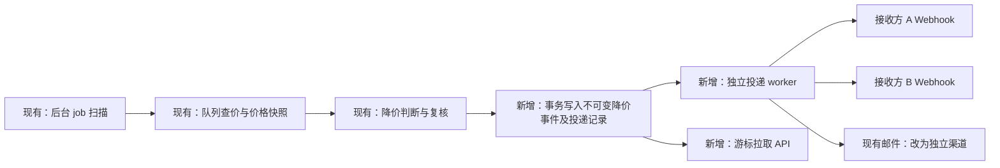

# 降价通知对外广播实施计划

日期：2026-10-21（Asia/Singapore）  
状态：计划，未实现广播、未修改服务配置、未发送通知。

## 1. 目标与选型

将现有降价提醒变成通用事件：**一次确认降价，生成一个 JSON 事件，向多个已配置 Webhook 接收方独立广播。** 提供游标拉取接口，供没有回调服务的调用方使用，也用于补漏。

第一期保持简单：

- 复用现有 Spring Boot、H2、调用方 Bearer 鉴权和降价复核逻辑。
- 订阅地址由服务端外置配置维护，不先做订阅管理后台或动态注册 API。
- 不引入 Redis、MQ、WebSocket、SSE 或单独通知服务。
- 接收端只需提供 HTTPS POST 接口，或定时拉取 JSON 事件；后续由接收端转发到自己的业务系统、群机器人或 App。
- 邮件继续作为可选通知渠道，与 Webhook 成功失败分开记录。

广播指向获授权的多个接收方，不等于匿名公开所有调用方的商品和推广数据。

## 2. 目前确实是后台 job

### 源码已确认

| 项目 | 当前行为 |
| --- | --- |
| 调度入口 | `PriceWatchScheduler.tick()`，使用 Spring `@Scheduled` |
| 调度频率 | 启动 20 秒后首次执行，每轮结束后间隔 30 秒再次执行 |
| 调度工作 | `PriceWatchCoordinator.tick()` 协调已有任务、处理提醒，再为到期关注商品安排查价或身份解析 |
| 实际查价 | `priceRefresh` / `resolveProductIdentity` 进入已有持久队列，由浏览器 owner 线程串行执行 |
| 默认商品周期 | 重点 4 小时、普通 10 小时、冷门 48 小时；还受实际调度窗口、预算和风险暂停约束 |
| 默认查价窗口 | `Asia/Shanghai`，06:00 至次日 01:00 |
| 默认开关 | `app.custom.priceWatch.enabled=true`；`notifyEnabled=false`，即监测默认开、邮件通知默认关 |
| 默认通知时段 | 08:00–23:00，以配置时区为准 |
| 降价复核 | 默认间隔 15 分钟；价格回升取消提醒，超过默认 30 分钟的新鲜度则要求重新取价 |

**30 秒是扫描到期任务的间隔，不是每个商品的访问频率。** job 在 rx-mimic 进程中运行，不是独立的 Windows 降价计划任务；服务停止时它也停止。

2026-10-21 本次只读检查：AnZhi 服务 ready，运行版本为 `bb3bd24e0b21e8a2a2695b2e781fadd1a836e617`；外置 `application-prod.yml` 的 `app.custom.priceWatch` 未发现显式覆盖。当前检查所用调用方能查看到 3 条活跃关注。该数量仅属于此调用方，不代表全服务总数，也不能单独证明某次查价已执行。

本次未通过运行时配置接口逐项核对环境变量覆盖，不能把仓库默认值当作所有线上有效值，更不能据此断言邮件已经开启。

源码依据：

- [PriceWatchScheduler.java](../../crawler-bootstrap/src/main/java/org/rx/crawler/task/price/PriceWatchScheduler.java)
- [PriceWatchCoordinator.java](../../crawler-bootstrap/src/main/java/org/rx/crawler/task/price/PriceWatchCoordinator.java)
- [AppConfig.java](../../crawler-bootstrap/src/main/java/org/rx/crawler/config/AppConfig.java)
- [application.yml](../../crawler-bootstrap/src/main/resources/application.yml)

## 3. 现有能力如何复用

现有 `PriceAlertService` 在同一比较序列内判断降价、复核与新鲜度，通知记录写入 `price_alert_outbox`。当前状态为：0 待复核、1 待发送、2 已发送、3 待重试、4 已取消。

当前发送接口 `PriceAlertSender.send(String body)` 只有邮件实现；发送失败 10 分钟后重试，每轮最多处理 20 条。它只有一份全局发送状态，没有逐接收方状态，也没有通用 JSON 事件。

因此不能简单地循环多个地址，再把“任意一个发送成功”记为整条提醒已发送，否则会漏发其他接收方；也不能因为邮件失败反复重发已经成功的 Webhook。

已有 `/api/v1/price-watches` 提供关注列表、关注商品、预算、暂停、恢复、手动刷新和价格快照。目前没有对外降价事件查询或广播接口。

相关实现：[PriceAlertService.java](../../crawler-bootstrap/src/main/java/org/rx/crawler/task/price/PriceAlertService.java)、[PriceWatchStore.java](../../crawler-bootstrap/src/main/java/org/rx/crawler/task/price/PriceWatchStore.java)、[PriceWatchController.java](../../crawler-bootstrap/src/main/java/org/rx/crawler/controller/PriceWatchController.java)。

## 4. 建议流程



1. 继续使用现有降价判断和复核规则，不因通知接入而额外开启浏览器或重抓商品。
2. 复核通过、快照仍有效且达到通知时段后，生成一次不可变事件。
3. 在同一数据库事务中写入事件、接收方投递记录，并标记原提醒已完成事件发布；更新用于抑制重复提醒的价格状态。
4. 独立 worker 发送网络请求；调度线程和浏览器线程只安排任务，不等待远端 HTTP。
5. 拉取 API 读取已发布事件，与某个 Webhook 是否投递成功无关。

事件只在正式发布时取得游标序号；不能直接把早期创建但尚未复核完成的 outbox ID 当作拉取游标，否则晚确认的旧记录可能被跳过。第一期保持单发布者串行提交，保证事件游标与发布顺序一致。

## 5. 通用事件格式

第一期使用普通 JSON，不要求接收端安装专用 SDK。以下为契约示例，不是真实降价记录：

```json
{
  "eventId": "12345",
  "type": "price.dropped",
  "version": 1,
  "occurredAt": "2026-10-21T12:00:00Z",
  "data": {
    "watchId": "101",
    "platform": "jd",
    "productId": "100000000001",
    "title": "示例商品",
    "shopName": "示例店铺",
    "productUrl": "https://item.jd.com/100000000001.html",
    "currency": "CNY",
    "baselinePrice": "100.00",
    "currentPrice": "90.00",
    "dropAmount": "10.00",
    "dropPercent": "10.00",
    "priceKind": 1,
    "priceField": "price",
    "observedAt": "2026-10-21T11:59:00Z"
  }
}
```

- `eventId`、`watchId`、商品 ID 按字符串传输；金额和比例用十进制字符串，避免浮点误差。
- `priceKind` 沿用已有数字字典：0 未知、1 普通售价、3 已说明的到手价/券后价。保留价格字段和观察时间，避免把不同口径的价格当作同一成交价。
- 字段来自已确认的快照和商品记录，事件发布后不覆盖内容；重试使用同一 `eventId` 和正文。
- 默认不广播 Cookie、调试路径、页面 HTML 或私人推广链接。确有推广链接需求时，为授权接收方显式开启该字段。
- 第一阶段仅推送 `price.dropped`；不将每次查价、价格不变或失败日志都广播出去。

## 6. 广播与接入接口

### Webhook：主动广播

服务端配置多个接收方，示意配置如下；配置名和接口均待实现：

```yaml
app:
  custom:
    priceWatch:
      broadcast:
        enabled: false
        subscribers:
          - id: business-a
            ownerIds: [caller-a]
            url: https://consumer-a.example.com/hooks/price-drop
            signingSecretEnv: PRICE_WEBHOOK_A_SECRET
          - id: business-b
            ownerIds: [caller-a]
            url: https://consumer-b.example.com/hooks/price-drop
            signingSecretEnv: PRICE_WEBHOOK_B_SECRET
```

两个地址都获授权订阅 `caller-a`，同一事件会分别投递。不同 owner 的数据默认隔离；管理员需要汇总多个 owner 时，在受控配置中明确列出授权范围，不提供匿名全量广播。

POST 正文直接为上面的事件 JSON，使用 `Content-Type: application/json`，不套同步 API 的 `Result` 包装。携带事件 ID、投递 ID、发送时间戳和 HMAC-SHA256 签名；签名覆盖时间戳及实际原始正文。每个接收方使用独立外置密钥，不将密钥放在 URL 或日志中。

接收方应先可靠保存事件，再返回任意 2xx；实际业务异步处理，并按 `eventId` 去重。返回 2xx 只表示接收方已接收，不代表其所有下游用户都已收到消息。

### 拉取：无回调地址也能接入

新增 `GET /api/v1/price-events?after=<cursor>&limit=100`，沿用现有 Bearer 调用方身份和 `success/code/message/data` 包装。

`data` 包含 `events`、`nextCursor`、`hasMore`。按已发布事件顺序读取，调用方处理成功后持久保存 `nextCursor`，中断后从上次游标继续；没有消息时返回空列表，不触发查价。

仅返回当前调用方有权读取的事件。首期保留 7 天；游标早于保留范围时返回明确的 `410 CURSOR_EXPIRED`，不能静默跳过。补发、订阅配置、重试管理第一期均不开放给普通业务调用方。

## 7. 最小持久化与投递规则

保留现有 `price_alert_outbox` 负责降价候选和复核，新增两张小表：

| 表 | 核心字段与用途 |
| --- | --- |
| `price_event` | `id`（发布游标）、`alert_id`（唯一）、`owner_id`、`type`、`version`、`payload`、`occurred_at`、`created_at`；保存不可变事件 |
| `price_event_delivery` | `event_id`、`subscriber_id`、`channel`、目标地址/配置版本、`status`、`attempts`、`next_attempt_at`、`last_http_status`、`last_error`、`sent_at`；唯一约束覆盖事件与接收方 |

邮件也作为一个独立接收渠道登记。新增加的接收方默认仅接收之后的事件，历史补发需要显式运维操作。新增配置不能把历史投递悄悄改投其他地址。

投递状态建议数字存储：0 待投递、1 投递中、2 成功、3 待重试、4 重试耗尽。记录领取时间；进程重启后恢复超时的投递中记录，避免永久挂起。

- HTTP 总超时初始建议 5 秒；独立有界 worker 投递，单接收方超时不阻塞其他接收方或浏览器任务。
- 首次立即尝试；失败后建议按 1、5、15、60 分钟退避，最多再重试 4 次。超过后标记耗尽并供运维查看，不无限重试。
- 2xx 为成功；网络失败、超时、429、5xx 重试。429 可参考 Retry-After，并设置等待上限；其余 4xx 作为配置或契约错误结束当前投递并告警。
- 至少一次交付：接收成功后服务端未记录成功就崩溃，可能重复发送；使用同一 `eventId` 去重，不承诺 exactly-once。
- 同一事件所有接收方独立结算，不能以一个全局 SENT 覆盖其他接收方状态。
- 订阅地址仅由服务端配置，限定 HTTPS 和允许的目标，不自动跟随重定向。

## 8. 与现有开关的兼容

现有 `notifyEnabled` 控制邮件；新增 `broadcast.enabled` 控制对外事件发布及 Webhook，初始默认关闭。必须调整现有 `flush()` 的入口判断，避免邮件关闭时连广播也被跳过。

| 邮件开关 | 广播开关 | 期望行为 |
| --- | --- | --- |
| 关 | 关 | 监测与复核继续，不启用新的对外通知 |
| 开 | 关 | 保持邮件通知能力 |
| 关 | 开 | 发布事件、Webhook 广播及拉取可用，不发送邮件 |
| 开 | 开 | 同一事件分别安排邮件和所有授权 Webhook |

沿用现有通知时段，时段内正式发布新的降价事件；已发布事件的失败投递可继续重试。不要因某个接收方失败回退降价判断，也不要反复新建事件。原有 outbox 的状态兼容和“最后已通知价格”的更新点需要一起迁移：新模式表示事件已可靠发布，不再表示所有接收方均成功。

停用所有通知后仍允许读取未过期历史事件。若价格监测总开关关闭，停止新查价和新事件产生；已发布事件的投递由独立广播开关决定。

## 9. 实施任务与验收

- [ ] 明确第一批接收方的地址、owner 授权范围和签名密钥环境变量；没有真实地址时用本地 mock 接收服务验证。
- [ ] 抽出结构化 `PriceDropEvent`，复用现有价格判断与复核，不解析邮件正文来拼事件。
- [ ] 新增事件和逐接收方投递表；事务发布、去重、状态兼容与保留期清理。
- [ ] 增加配置型订阅列表、独立投递 worker、签名、超时、重试和耗尽记录。
- [ ] 新增带游标拉取接口，复用 Bearer 鉴权及 owner 过滤。
- [ ] 将现有邮件接入独立渠道，并覆盖四种开关组合。
- [ ] 测试一次降价同时被 A/B 接收；A 成功、B 失败时只重试 B；邮件失败不影响两者。
- [ ] 测试进程重启、重复请求、接收成功但确认丢失、游标补漏及过期、跨 owner 访问拒绝。
- [ ] 测试复核取消、过期快照不发布，以及回升后再次真实降价的事件生命周期，避免沿用旧 event_key 吞掉新一轮提醒。
- [ ] 记录待投递数、最老积压、成功率、耗尽数与投递耗时；先用模拟价格快照验收，不为测试广播额外频繁访问商品页。

本次完成的是源码调查、远端只读基线检查和本计划；未编译或运行新增广播功能，未修改配置、发送降价通知或部署。

## 10. 资料依据

本方案的 Webhook 建议参考 [GitHub 官方 Webhook 最佳实践](https://docs.github.com/en/webhooks/using-webhooks/best-practices-for-using-webhooks)：使用共享密钥验证来源，接收端及时响应并异步处理，处理漏送与重投。本文的事件字段、广播表、重试间隔和权限范围为结合本项目提出的设计，并非引用 GitHub 的具体交付保证。
