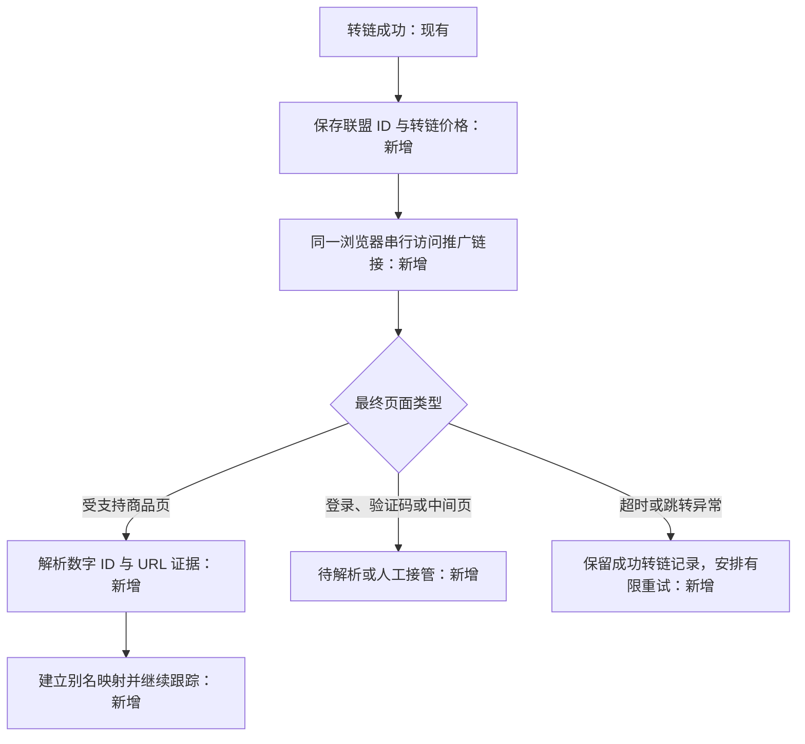

# rx-mimic 联盟商品价格跟踪与降价提醒计划

- 日期：2026-10-21。
- 状态：计划草案；已核对当前仓库代码及公开资料，尚未实施。
- 范围：京东联盟、淘宝联盟的搜索结果留存、转链商品跟踪、价格历史、分时查价、降价提醒。
- 业务时间统一使用 `Asia/Shanghai`，当前与用户所在 `Asia/Singapore` 同为 UTC+8；不修改 Chrome 的语言、时区或硬件指纹。
- 依据：用户本轮需求与补充说明、仓库 `AGENTS.md`、当前源码。**京东、淘宝联盟商品 ID 均按不透明的加密 ID 处理；访问转链后的最终商品 URL，才能确认原始数字商品 ID。**

## 1. 建议先做什么

在已有搜索、转链链路后增加业务存储，使用现有 H2、任务队列、本机 Chrome 和登录态。首期默认持续跟踪“成功转过链的商品”；搜索命中的商品保存快照，但不全部自动轮询，用户可主动加入跟踪。

查价主要回到联盟选品页按联盟 ID 精确查询，避免每次重新转链、打开详情和下载图片。首次转链后访问推广链接，解析最终商品 URL，建立“联盟加密 ID ↔ 原始数字商品 ID”的映射。数字 ID 用于归档关联与商品直达，联盟 ID 用于后续联盟查询；二者不能混用。

允许的后台操作窗口采用 **06:00 至次日 01:00**，其中早晚边缘时段少量执行，01:00—06:00 默认休息。这个窗口是运营配置，不是已证实的安全时段。商品查价次数按关注程度、活动节点、近期价格变化分配，晚 8 点附近优先查相关重点商品；早 9 点先小样本验证。

首期建议从 **30 个活跃跟踪对象，京东/淘宝各约 15 个**试运行。观察一至两周的耗时、成功率、有效降价率和人工接管次数后再扩容。数量、频次、通知阈值均可配置。

## 2. 调研结论：操作时间与改价节点

### 2.1 有依据的事实

| 观察 | 资料依据 | 对本方案的意义 |
| --- | --- | --- |
| 晚 8 点是部分平台大促的公开启动时间 | 京东官方介绍 2024 年 618 于 5 月 31 日 20:00 启动，并解释晚 8 点购物安排；见[京东官方文章](https://jdcorporateblog.com/jd-com-unveils-2024-618-grand-promotion-immediate-access-from-8-pm-on-may-31/) | 对已公布的活动，安排开始后的优先检查有依据；不能据此推断每天所有商品都在 20:00 改价 |
| 淘宝/天猫也存在 20:00 大促节点 | 阿里官方媒体 Alizila 的 2025 年双 11 回顾写明结算期于 10 月 20 日 20:00 开始；见[官方回顾](https://www.alizila.com/news-roundup-11-11-brand-performance-designer-brands-shine-and-ai-to-combat-extreme-heat/) | 这是历史活动实例，不能直接作为 2026 年或日常活动日历；该页正文直连本次返回 403，时间信息来自可检索的正文摘录 |
| 用户活跃高峰会随活动变化 | [QuestMobile 2026 年 618 洞察报告](https://www.questmobile.com.cn/research/report/2070037399023398914/)指出，重要节点活跃高峰较以往晚 8 点向前移动 | 不能把真人活动规律固定成一个整点模板；该报告研究的是用户活动，不是商家改价 |

截至本次检索，**没有取得可信的一手证据，证明 JD/TB 商品普遍在每天 09:00 和 20:00 改价，也没有证据证明 06:00—01:00 能避免风控**。不要把返利推广软文里的时间表当成平台规律。

### 2.2 需要区分的几种变化

1. 商家修改基础售价：时间取决于商家，不能由买家活跃时间推断。
2. 活动价、优惠券开始或结束：如页面提供精确时间，可据此安排相关商品的采样。
3. 会员、新人、地区、数量和账号优惠变化：可能只是条件变了，不属于同口径降价。
4. 联盟展示更新延迟：与主站更新时刻可能不同；首次观察到变价，不等于真实变价发生在该分钟。

因此采用“**公开活动时间优先 + 商品自身观测修正 + 少量其他时段探索**”。0 点只作为跨日优惠切换的候选观察点，有活动或数据支持时才增加采样，不默认全量午夜刷新。

### 2.3 用自己的数据验证

- 记录每次有效查询时间、上次有效查询时间、价格变化、命中字段、优惠条件和耗时。
- 在每日预算内，让约 10% 的观察覆盖其他时段，防止只查 20 点就得出“都在 20 点降价”的循环结论。
- 按平台、品类、商品统计“每 100 次有效查询发现多少次可比较的降价”，同时统计风险与失败情况。
- 将变化时间表示为 `(上次同口径观察时间, 本次观察时间]`，保留区间，不伪造准确改价时刻。
- 一至两周只做初步调整；低频商品和活动日样本不足时继续保留默认策略，不训练复杂模型。

## 3. 当前项目可以复用的部分

| 能力 | 当前证据 | 本次改造 |
| --- | --- | --- |
| 技术栈 | 根 `pom.xml`：JDK 21、Spring Boot 3.5.14、Playwright 1.62.0、H2 2.2.224 | 沿用项目业务写法，不引入新队列、Redis 或新数据库 |
| 联盟搜索与转链 | `task/jd/JdUnionPromotionTask.java`、`task/tb/TbPromotionUrlTask.java` | 在成功结果公共处理处接入快照与跟踪，兼容批量子任务 |
| 联盟数据读取 | `JdUnionPageApi.java`、`TbUnionPageApi.java` | 复用现有已登录页面接口及必要的页面兜底，增加只查询价格的轻量任务 |
| 持久数据库 | `config/CookieJarConfig.java:15` 创建 `EntityDatabase`，默认 `./data/browser-task-db` | 增加价格业务表和索引，使用现有事务能力 |
| 异步 API 与队列 | `AsyncTaskController`、`CustomCrawlQueueService` | 继续使用 `/api/v1/tasks`；增加内部任务来源、优先级和后台准入 |
| 登录与人工接管 | 现有 `WAITING_USER`、持久化任务状态、统一 profile | 登录或验证码出现时暂停后台任务，等待人工恢复 |
| 邮件传输 | `MailLoginNotificationService` 已使用项目邮件能力 | 抽出可复用传输层；价格提醒单独建持久 outbox 与去重状态 |
| JSONL 结果 | `data/jd-union/output.jsonl`、`data/tb-union/output.jsonl` | 保留现状，用于审计和可选历史回填；不能替代价格数据库 |

上述 Java 简写路径均相对 `crawler-bootstrap/src/main/java/org/rx/crawler/`。

需要明确的现状限制：

- 队列表虽有 `priority`，但 `enqueueOwned` 当前插入值固定为 0；“前台优先”需要实际改造，不能视为现成能力。
- 当前队列每秒领取待执行任务，没有计划执行时间字段；一天的计划应留在价格业务表，临近到期才少量入队。
- 任务结果默认保留 7 天，到期会清理结果，不能承担长期价格历史。
- 同一 profile 只允许一个浏览器，页面操作串行；两个标签不代表两个并发执行器。当前 `WAITING_USER` 会阻止全队列领取，方案按这个实际行为处理。
- 已有 `LoginKeepAliveService` 使用系统时间窗口，配置错误时回退全天开放；新查价调度不得复制这个回退策略。保活也要纳入统一访问预算与休息窗。
- `docs/jd.md`、`docs/tb.md` 的部分数字 ID 约束与用户确认的加密 ID 事实有差异，实施时同步校准各自平台文档，不能为通过旧校验把加密 ID 强转数字。

## 4. 商品入库与真实 ID 解析

### 4.1 两类入口

| 触发 | 保存内容 | 自动进入长期跟踪 |
| --- | --- | --- |
| 联盟搜索成功 | 本次返回商品、展示价、来源与时间；同商品去重 | 默认否，支持手动关注 |
| 单个/批量转链的某个商品成功 | 商品、联盟 ID、推广记录、当时的价格快照 | 默认是；批量仅处理成功子项 |
| 首次访问转链后到达商品页 | 最终 URL、真实数字商品 ID、映射证据与解析时间 | 补全身份，不覆盖原始联盟价格 |
| 后台查价成功 | 同商品的新价格快照、下次计划、可能的提醒事件 | 保持当前跟踪状态 |

“转链失败但搜索已有价格”可以保存搜索快照，不能把它记成转链成功。超过活跃跟踪数量上限时仍保存转链记录，新跟踪项进入待激活队列，并向调用方说明状态。

### 4.2 ID 模型

- `platform`：1=京东，2=淘宝/天猫。
- `unionProductId`：联盟返回的原始 ID，**两平台均保存为 String，作为不透明标识**；旧字段名 `skuId` 或 `itemId` 不代表它必然是数字。
- `platformProductId`：从已确认的最终商品 URL 取出的数字商品 ID，仍保存为 String，避免跨语言整数精度问题。
- `platformSkuId`：具体规格标识；淘宝商品数字 ID 不等于 SKU ID，拿不到时为空。
- `identityStatus`：0=待解析，1=已验证最终商品页，2=需人工确认。
- 联盟别名以“平台 + profile/联盟账号上下文 + 加密 ID”唯一；不同上下文不假定加密 ID 稳定或通用。

商品内部主键独立生成，不使用加密 ID 或短链接作为数据库主键。以后遇到同一数字商品 ID 的新联盟 ID，可建立新别名；历史映射不覆盖删除。只有确认同商品的证据才合并主档，标题、店铺相似不能单独作为依据。

### 4.3 首次转链后的解析流程

解析约束：

1. 使用本机 Chrome 的正常导航，等待实际跳转稳定；不依赖一次 HEAD 请求就断言能拿到最终 URL。
2. 仅从经过域名白名单与路径验证的商品页提取：如 `item.jd.com/{id}.html`、淘宝/天猫商品页的数字 `id`。移动端其他形式先补规则和样本，不能从任意 URL 的 `id` 参数取值。
3. 验证最终 URL 对应实际商品页；联盟中转页、登录页、活动页、错误页和推荐商品不算身份解析成功。可用标题/店铺作辅助核验，明显不一致时转人工。
4. 首次解析、别名过期或映射冲突时才再次访问推广链接；普通查价不重复点击短链。额外导航也计入访问预算。
5. 解析失败不把转链改成失败，身份保持待解析；联盟 ID 仍可用时继续同一联盟来源的有限跟踪，不能跨身份合并。
6. 新增独立 `ResolveProductIdentity` 内部任务，接到现有串行执行器；高优先级安排但不阻塞原转链接口交付。不另起 Chrome 抢占 profile。

同一数字商品 ID 不自动意味着同一个比较对象；不同规格、优惠资格和页面价格来源仍要分别建价格序列。

## 5. 价格口径与降价判断

### 5.1 每个快照至少保存什么

| 字段 | 用途 |
| --- | --- |
| 商品主键、联盟别名、可空规格 ID | 证明观察的是哪个对象 |
| `rawPrice` | 页面/接口原始价格文本，便于复核 |
| `priceAmount` | `DECIMAL(18,2)`，Java 用 `BigDecimal`；无有效价格时为空 |
| `source`、`sourceField` | 联盟接口、联盟页面、商品详情；以及实际命中的价格字段 |
| `priceKind` | 0=未知展示价，1=普通售价，2=已说明条件的活动价，3=明确券后价，4=价格区间 |
| 优惠条件及原文 | 券门槛、券有效期、会员/新人、地区、数量、规格、运费是否已知 |
| `comparableKey`、`comparable` | 来源、身份、规格与价格条件的标准化摘要；能否进入自动比较 |
| `observedAt`、`lastSeenAt`、`taskId` | 实际观察时间、最新有效观察、任务证据；不能使用晚到结果的处理时间冒充采样时间 |
| `fetchStatus`、`qualityReason` | 成功、缺价、风控、身份不符、不可推广、未知等 |

当前 JD 解析按 `finalPrice / wlPrice / price / purchasePrice` 等字段回退，TB 按 `unionPromotionPrice / finalPromotionPrice / zkFinalPrice / price` 等字段回退。实施时记录真正命中的字段及页面标签，逐个确认语义，不能只保留一个无来源的 `price`。

规则：

- `2?`、`待登录`、价格区间、空值、无法说明的定金/尾款不作为确定价格；0 元与异常极低价格进入复核，不直接报警。
- `couponAmount` 不再盲减一次，已是券后价时重复减券会制造假低价。
- 联盟价与详情页价分别存储，默认不跨来源计算降幅；首次跳转详情页只是身份核验，不改变联盟价基线。
- SKU 不确定时只可跟踪“同口径的商品展示价”，提醒明确标注“商品展示价下降，规格与最终结算价请确认”。来源口径也无法确认时只留历史，不自动提醒。
- 页面源字段、SKU 或优惠资格改变时，创建新的比较序列。新序列首个快照仅建基线，不与旧序列直接比较。

### 5.2 默认提醒规则

首期建议：同一比较序列，相对**该订阅当前序列的首个有效基线**下降，同时满足“降幅至少 3% 且降额至少 1 元”。转链创建订阅时，默认使用首次转链的有效快照；从搜索结果直接关注时，使用当次可比较快照，否则等首次有效查价建基线。条件变化产生新序列时，重新用该序列首个有效快照建基线。首次转链价格单独作为不可变历史参照，不能跨序列直接计算降幅。这是可配置的产品默认值，低价商品可改用更小绝对阈值；也支持设置目标价。后续再次转链保存新转链价格，但不悄悄重置旧订阅基线。

同时保留当前序列基线、首次转链历史价、上次有效观察价、该订阅当前序列上次已提醒的价格。首期低于当前序列基线触发首次提醒；重复提醒还须比同序列上次已提醒价进一步下降并达到配置阈值，或首次跨过新目标价。单纯涨回去再降到已通知过的价格，默认不重复通知。搜索关注尚未转链时，首次转链历史价为空，不影响同序列跟踪。

例如：首次转链价 100 元，观察到 95 元，达到阈值，建立候选；后续 95→100→95 不重发。降到 90 元达到再次提醒阈值后可以新发。邮件展示基线 100、上次观察值、当前 90、各自观察时间与优惠条件，避免“比谁便宜”不明确。

正常降价候选在 10—30 分钟内安排一次有限复核，确认仍在阈值内才通知；复核与原观察共享预算，不形成无上限重试。明确、即将结束的活动可配置单次高可信快照通知，但需标注“单次观察”，该模式默认关闭。

补充约束：复核必须是同一来源、身份和比较序列；阈值比较用原始 Decimal 值，最后展示时再格式化。新用户、新订阅可有各自基线与提醒状态，不能共用全局“已经通知”标记。

## 6. 分时调度：少量、分散、按价值检查

### 6.1 时间窗口

以下时间和频次均为首轮试运行参数，不是平台安全阈值。允许窗口内也不持续操作；人工验证码、平台限制与运行健康优先于时间计划。

| 时间 | 默认安排 |
| --- | --- |
| 01:00—06:00 | 不发起后台查价与普通保活；到点停止领取新任务，已执行操作在安全点结束 |
| 06:00—08:00 | 仅少量积压重点项，额度约占日后台预算 5%，不补跑整夜任务 |
| 08:00—19:30 | 普通商品均匀分散；09 点仅选择少量探索样本，不做全量刷新 |
| 19:30—21:30 | 已知活动前后及重点商品优先；20 点后的检查强于活动前，仅影响相关商品 |
| 21:30—23:00 | 剩余普通查价、降价复核 |
| 23:00—01:00 | 低频；若明确存在跨日优惠变更，可在 00 点之后检查少数相关商品 |

跨午夜判断按 `[06:00, 次日01:00)` 实现，01:00 不再准入。业务日以当地 06:00 为边界，00:00 不重置全部预算造成额外突发。时区和时间格式配置错误时禁止启动后台调度并给出错误，不能回退全天开放。

### 6.2 商品分层

| 分层 | 默认频次 | 升降级 |
| --- | --- | --- |
| 重点 | 每业务日 3—4 次，其中一次尽量覆盖已知活动开始后 | 用户关注、接近目标价、近期有效变价、明确活动 |
| 普通 | 每业务日 1—2 次，分布在不同窗口 | 转链后默认进入普通层，预算不足时减少次数 |
| 冷门 | 每 2—3 个业务日一次 | 长期未关注且多日未变价；收到新转链/主动关注可恢复 |
| 暂停/待人工 | 不自动查价 | 登录、验证码、长期查不到、身份冲突、用户暂停 |

普通转链商品默认活跃跟踪 30 天，之后转冷门；90 天无人关注可暂停，保留历史。用户明确置顶的商品不自动过期。这些保留策略可配置，不直接删除已有记录。

已知活动开始时刻为 T：预算足够时给相关重点项安排 `T 前 15—45 分钟`一轮基线、`T 后 2—20 分钟`一轮观察；仅对发现降价的候选安排后续复核。窗口不是逐商品 SLA，受串行队列和人工任务影响。不要在整点为每个商品都提交任务。

### 6.3 执行机制

1. `PriceRefreshPlanner` 只计算业务表中的 `nextCheckAt`；保存已经计算的时间，重启后不重新为全部商品随机排程。
2. 每次只准入少量临近到期任务，初期后台待执行上限 2；前台有任务时暂停后台追加。后台运行项只在安全点让出，不硬中断页面动作。
3. 改造队列内部提交接口区分来源与优先级：前台搜索/转链高于后台查价；过久未执行项做有限优先级提升，但不能饿死前台。
4. 共用一个浏览器执行器，所有页面任务、ID 跳转解析、登录保活均纳入同一个资源仲裁。保持现有真人输入、正常 Chrome、持久 profile 与串行页面操作。
5. 以访问预算和会话节奏限制总量；小批执行后留出休息，禁止仅靠随机 sleep 就认定不会被风控。短时间的随机抖动只用于避免扎堆。
6. 领取时再检查允许窗口、冷却、预算、用户暂停、已有活动任务和排队负载；已入队但尚未运行的后台任务也要再检查，防止过窗执行。
7. 查询必须精确匹配目标联盟 ID 或已验证身份；查到推荐商品、相似标题或关键词第一条不得作为目标商品新价格。
8. 任务幂等键使用“跟踪项 + 本次计划编号”。同项已有未完成任务则合并；结果过期或进程重启后先对账再决定是否重试，不重复提交。
9. 失败或过窗任务重新安排未来一次，不补跑每一个漏掉的旧周期。晚到旧快照可以入历史，但不能覆盖更新的当前价或触发迟到重复提醒。

### 6.4 容量与预算算例

**后台预算上限不等于每天必须完成的次数，更不是平台公开允许额度。** 首期可设全 profile 最多 180 次业务访问尝试/业务日，其中后台子额度最多 120 次，预留 60 次给前台；搜索、转链、手动刷新、ID 解析、保活与后台查价全部计入总量，并按平台分配额度。后台可用量取“后台子额度剩余”和“总量剩余扣除尚未使用的前台预留”中的较小值；前台超过预留时继续压缩后台余量，达到总上限则延后新访问，向调用方明确说明。实际值再受会话休息、网络请求量与风险反馈收紧，不能为了完成前台请求静默绕过平台冷却。

30 个商品试运行的粗略预算：普通查价最多 60 次 + 重点活动追加 12 次 + 其他时段探索 6 次 + 复核 6 次 + 普通失败重试 6 次 = 90 次。首次 30 个商品的跳转解析另消耗最多 30 次，因此首次建档可以分批跨日完成；登录保活、页面兜底和其他额外访问占用剩余额度，超出即顺延，不能偷偷加量。

一次业务任务可能产生多次接口请求和页面跳转，因此同时记录“业务尝试数、实际商品数据请求数、导航数”，接口重试和页面兜底都计入对应预算。静态资源流量用于观测，不能把 120 次任务误写成 120 个 HTTP 请求。

容量估算：`可执行任务数 ≈ 可用窗口秒数 × 后台可用比例 / 单任务有效耗时`。其中有效耗时包含操作时间、任务间隔和摊销休息。假设 19 小时窗口、后台占 60%、有效耗时 330 秒，则约为 `19×3600×0.6/330≈124` 次；这只是算例，实测不够则下调计划，不能提高浏览器并发补偿。

这也意味着：若有 1000 个跟踪商品，日均 2 次至少需要 2000 次观察，单 profile 下不承诺全部覆盖。必须降低普通/冷门频率、限定活跃池，或以后评估已有授权的官方联盟 API。官方 API 的账号权限、配额和价格字段适用性应单独验证，不能把页面内部网关等同于正式授权 API。

### 6.5 风控与故障处理

| 情况 | 处理 |
| --- | --- |
| 登录失效/验证码 | 转人工等待，暂停后台新增；沿用现有队列停止领取行为，不自动绕过 |
| 明确限流/429 | 优先遵循服务端等待指示；无指示则先冷却 30—60 分钟，重复出现延长到数小时，并降低次日后台预算 |
| 403/页面限制 | 区分登录、限制与普通错误；按平台暂停，必要时人工处理，不按一般网络失败连续重试 |
| 普通网络错误 | 仅有限退避重试，建议最多 2 次额外尝试，且受当天剩余额度限制；无额度顺延 |
| 查无联盟商品 | 标记不可推广/未知，降低频率；不能推断已下架，更不能写入 0 元 |
| 单个平台持续失败 | 暂停该平台后台；若存在全局 WAITING_USER，按当前实现整体等待 |
| 调度积压 | 显示覆盖率和数据陈旧时间，减少低优先级采样，不集中追赶 |

## 7. 存储设计与一致性

首期复用 H2 2.2.224 与 `EntityDatabase`，表结构通过版本化、可重复执行的迁移创建。沿用当前 SQL/Repository 写法，不为此单独引入 MyBatis Plus。

| 新表 | 核心字段与索引 |
| --- | --- |
| `price_product` 商品主档 | 内部主键、platform、可空 platformProductId、title、shop、image、identityStatus、createdAt、lastSeenAt；索引 platform+platformProductId；未解析项不能因空 ID 被错误合并 |
| `price_product_alias` 联盟别名 | productId、platform、accountContext、unionProductId、resolvedUrl、resolvedAt、证据引用；唯一键 platform+accountContext+unionProductId |
| `price_promotion_record` 转链记录 | ownerId、productId/aliasId、taskId、子项序号、adSiteName、promotionUrl、snapshotId、createdAt；唯一键 taskId+子项序号；同商品不同推广位保留不同记录 |
| `price_watch` 跟踪订阅 | ownerId、productId/aliasId、比较对象摘要、profile、baselineSnapshotId、targetPrice、降额/降幅阈值、priority、status、nextCheckAt、lastAttemptAt、lastSuccessAt、lastNotifiedPrice、当前任务引用；唯一键 ownerId+跟踪对象，索引 status+nextCheckAt |
| `price_snapshot` 价格观察 | 第 5 节价格与质量字段，金额 DECIMAL、时间带明确 UTC 语义；唯一键 taskId+结果项+观察来源，索引 productId+observedAt 及 comparableKey+observedAt |
| `price_alert_outbox` 提醒事件 | watchId、事件键、baselineSnapshotId、candidateSnapshotId、confirmedSnapshotId、payload、status、attempts、nextAttemptAt、sentAt；事件键唯一，索引 status+nextAttemptAt |

业务枚举用数字存储，中文写注释：平台 1=JD/2=TB；订阅状态 0=待激活/1=跟踪/2=暂停/3=待人工；提醒状态 0=待复核/1=待发送/2=已发送/3=待重试/4=取消；身份与价格类型见前文。不要用任务状态替代订阅状态。

一致性要求：

- 在任务结果成功持久化的公共路径接入业务落库，覆盖 JD/TB、单个/批量和内部调用；按 taskId+子项建立唯一约束，不在多个 Controller 分别重复写。
- 尽量让任务成功结果与对应商品/转链/快照在同一数据库事务中提交，**事务内不做浏览器访问或发送邮件**。若短期无法共事务，先持久化待处理事件，并在结果保留期内对账补偿，不能只发一个可能丢失的内存事件。
- 浏览器副作用已成功但业务落库失败时，优先重放已保存结果，不为了补档重新转链；对无法证明结果的中断任务遵循现有显式恢复机制。
- 降价确认、持久提醒事件与通知状态变更有事务边界；发送成功后再标记 sent。通知失败只重发消息，不重新抓价。
- SMTP 通常不能保证端到端恰好一次；用稳定事件 ID/Message-ID 与 outbox 尽量去重，接受发送成功后进程崩溃造成极少量重复的边界。
- ownerId 必须来自现有认证上下文；查询/改订阅/取提醒均校验归属。共用采集结果也不共享用户目标价和通知状态。

保留策略建议：价格观察先保留 180 天，变化记录及转链基线保留更久；首期不自动删除历史，先看实际库大小再确定归档迁移。任务结果过期不影响价格历史。大批图片、完整 HTML、Cookie 和签名不放价格表；调试证据沿用受控目录，业务日志不输出推广追踪参数与凭据。

## 8. 降价提醒与操作入口

首期复用现有邮件能力，新增价格提醒服务。这里只定义能力范围，不冻结接口 URL 或完整 DTO；具体实现阶段沿用当前 `success/code/message/data` 包装、调用方隔离及任务 API 契约。

需要的能力：

1. 查看“已转链商品/跟踪列表”：价格来源、基线价、最新观察价、最后成功时间、身份解析状态、下次计划与暂停原因。
2. 从搜索结果加入跟踪，设置目标价、阈值、关注级别；支持暂停/恢复。
3. 查看价格历史，分开展示不同来源与条件，明确“尚无可比较基线”。
4. 手动刷新仍走同一受控队列，不绕过登录状态与总预算；近期刚成功的请求可返回缓存，并标明观察时间。
5. 查看提醒投递状态与失败重试，不用再次查询商品来判断邮件是否发出。

首期以跟踪服务与受控 API 为交付核心，可配一个简单管理列表；不把完整商品管理前端作为基础能力上线的前置条件。

通知包含：平台、商品和规格说明、当前序列基线、可空的首次转链历史价、当前展示价、降额/降幅、采样与复核时间、优惠适用条件、商品直达链接、可用时的推广链接，以及暂停跟踪入口。推广链接和优惠券可能失效，应标注生成时间；刷新推广链接属于另一个用户任务，不在每次价格观察中重建。

同用户短时间多个降价可以合并为一封摘要。建议默认通知时段 08:00—23:00，其他时段先入 outbox；发送前要求同口径有效快照不超过 30 分钟，可配置更短期限。没有新鲜快照时按预算复核，额度不足则暂缓发送；已恢复原价或优惠已过期的取消提醒，不能次晨直接发送昨夜旧价格。活动紧急提醒与夜间通知需用户后续明确开启。

## 9. 实施拆分与预估

以下为单开发者粗估，不包含等待登录、平台页面变化及通知渠道配置的外部时间；每阶段可独立验证。

| 阶段 | 工作与落点 | 验收结果 | 粗估 |
| --- | --- | --- | --- |
| P0 口径与身份样本 | 每平台选取 2—3 个已有转链样本，核实加密 ID、最终 URL、页面价格标签、可精确查询路径；读取已有结果优先 | 有可复查的身份映射、字段语义与失败样本；所有真实访问计入预算 | 0.5—1 天 |
| P1 入库与 ID 解析 | 新增 `service/price/` 与 Repository/迁移，接公共成功路径，增加串行跳转解析任务 | 搜索只留存；成功转链自动建跟踪；重放不重复；解析失败可恢复 | 1—2 天 |
| P2 查价与分时计划 | 新增价格任务、Planner、预算/冷却；改造内部优先级与保活准入 | 单浏览器串行，06—01 跨日正确，前台优先，积压不补洪峰 | 1.5—2.5 天 |
| P3 提醒与简单管理 | 降价规则、复核、outbox、邮件传输复用、查询/暂停能力 | 有同口径降价证据，持久去重、失败可重投、权限隔离 | 1—2 天 |
| P4 试运行 | 30 个活跃对象，小规模观察一至两周，按数据调频 | 有覆盖率、耗时、风险与误报记录，再决定扩容 | 开发验收 0.5—1 天，另加观察期 |

初步开发工作量合计约 4.5—8.5 天。若精确联盟 ID 查询在某平台不可用，必须先调整该平台刷新方案与预算，再评估工期；不能用标题搜索第一条替代。

代码/POM 实施后遵循项目要求：构建 `crawler-api` 并同步相邻 xiaofan 的依赖包，关键抓取变化执行实际 JD/TB 链路验证。部署、远端/CI 配置变更另行按仓库权限规则执行，本计划不修改它们。

历史补录作为可选后续：只导入 JSONL/现存任务里成功的转链子项，保留原始时间和 ID；缺价格、身份或口径的记录标记待补。导入不访问全部短链，身份解析按预算分批进行，不能把历史价格当当前价。

## 10. 验收场景与运行指标

| 场景 | 预期 |
| --- | --- |
| JD/TB 均返回加密 ID | 原值完整保留；通过转链最终商品 URL 提取数字 ID，不强转旧字段 |
| 转链跳到登录/活动/中间页 | 转链记录保留，身份待解析，不误取参数当商品 ID |
| 同商品多次转链或不同推广位 | 商品合理归并、转链记录保留，旧订阅基线不被重置 |
| 批量一部分失败、结果重放 | 只建成功项；任务与子项幂等，不重复快照和跟踪 |
| 联盟价与详情页价不同、券后价重复减券 | 分来源保存，不跨口径提醒，不重复扣券 |
| 同商品不同 SKU/会员/地区/数量 | 分比较序列；未知条件明确标识，不承诺 SKU 结算价 |
| 缺价、打码、无联盟商品、出现推荐结果 | 不记 0 元，不误报下架，不拿推荐品替代 |
| 价格满足阈值、复核恢复、再次降价 | 首次复核有效才通知；恢复取消；达到再次下降阈值才新发 |
| 00:00、00:59、01:00、05:59、06:00 | 跨日窗口和业务日预算边界正确；已入队后台项执行前复检 |
| 平台限流、登录/验证码、队列积压 | 冷却或人工接管；不持续重试，不并发抢浏览器、不补跑洪峰 |
| 前台转链与后台查价相遇 | 前台先领取；后台当前动作安全结束，无 profile 冲突 |
| 重启、晚到结果、邮件发送失败 | 排程和去重可恢复，当前价不倒退；邮件失败不触发重抓 |
| 多调用方订阅同商品 | 数据与通知状态隔离，无权访问返回现有权限语义 |

运行至少记录：

- 各平台业务尝试数、商品接口请求数、导航数、当日剩余额度、冷却状态。
- 活跃跟踪量、按层覆盖率、价格数据年龄、排队延迟与查价 P50/P95 耗时。
- 登录失效/验证码/限流比例、身份解析成功率、联盟 ID 精确匹配失败率。
- 可比较价格比例、每 100 次有效观察的有效降价数、复核取消率、人工误报反馈。
- 提醒待发送/重试量、投递成功率、采样至通知延迟；漏价无法仅靠轮询证明为零。
- H2 文件大小、快照增长、JVM 堆与堆外直接内存、Chrome RSS、浏览器存活状态。不能只看 JVM 堆判断整机资源是否正常。

验收先用固定输入验证价格、ID、幂等与跨日时间逻辑，再执行少量真实联盟查询/转链跳转/邮件投递；实际邮件仅发往用户配置并确认的接收地址。评估标准是记录准确、预算有效、异常可恢复；不承诺“永不触发风控”或“捕获每一次瞬时降价”。

## 11. 建议默认值与实施前需补齐的信息

已确认需求：JD/TB 联盟商品留存；转过链商品后续跟踪；降价提醒；分散访问；两平台加密 ID 通过转链最终商品 URL 映射数字 ID。

本文建议而尚未由用户逐项确认的默认值：搜索只存快照、转链成功自动跟踪；首批活跃 30 个；06:00—01:00 可执行；普通每日 1—2 次、重点 3—4 次且受总预算限制；3% 且 1 元阈值；邮件首发；通知时段 08:00—23:00；30 天转冷门、90 天可暂停。

进入实施时需补齐：预计日新增转链量与长期活跃量、邮件接收人/现有传输配置是否可用、是否需要精确 SKU 价格、现有推广短链解析样本、明确活动日期与时间来源。以上不妨碍先完成数据结构、记录与调度逻辑，涉及真实外发和活动承诺的部分需具备对应配置/证据。

## 12. 本文验证记录

- 已只读核对根 `pom.xml`、`AGENTS.md`、H2 初始化、联盟 DTO/解析器、公共持久队列、邮件通知、登录保活及现有接入文档。
- 已检索并引用京东官方、阿里官方媒体与 QuestMobile 自有报告；历史活动实例与当前通用规律分开表述，未将用户活跃数据当作商家改价数据。
- 已按用户最新补充，统一采用两平台加密联盟 ID，并以转链最终商品 URL 确认数字商品 ID。
- 本次仅新增计划 Markdown，不修改源码、部署配置或现有工作区改动。真实价格查询、跳转解析、调度与邮件投递均**未验证**；它们属于实施阶段验收内容。
