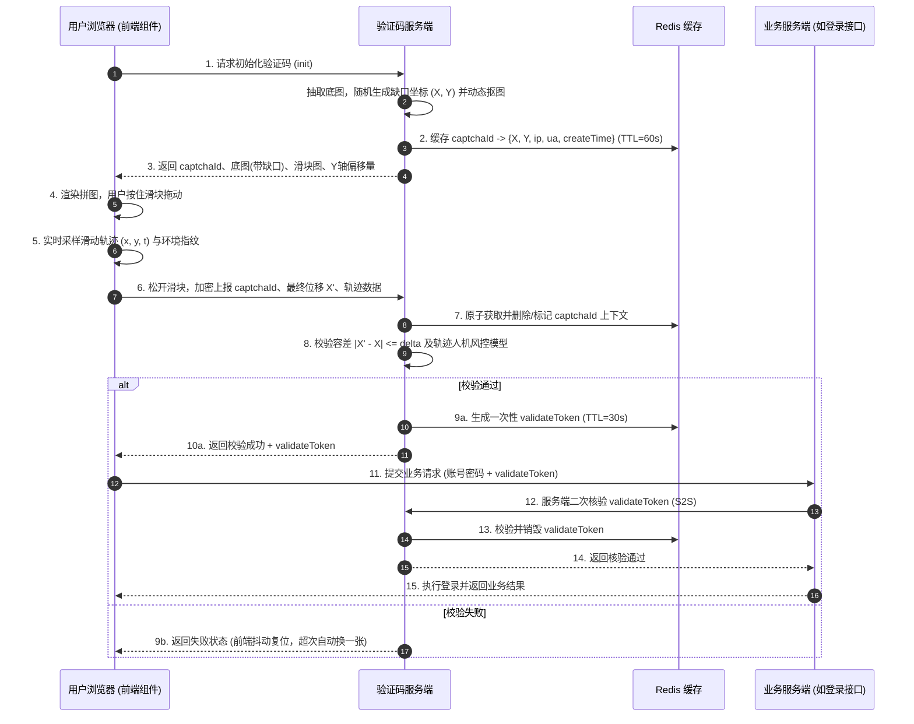

> 归档于 2026-11-24。这是整理前的原文，含当时的验收和草稿。现行行为以 docs/ 根目录说明为准。

# 滑动拼图验证码（Slider CAPTCHA）技术实现方案

本文档参考京东联盟等主流业务场景中的滑动拼图验证交互，系统梳理从**架构设计、动态图像生成、前端交互与轨迹采集、服务端校验与风控对抗**到**业务闭环接入**的完整工程落地细节。

---

## 1. 系统整体架构与交互流程

一个安全可靠的滑动拼图验证码绝不仅仅是“前端拼对齐”，而是一套**前后端协同、状态受控、结合人机行为风控**的验证闭环。核心原则是：**前端只负责展示与采集，所有坐标真值与通过凭证均由服务端生成并校验。**

### 1.1 核心组件划分
* **前端 SDK / 组件层**：负责弹窗渲染、底图还原、PC/移动端拖拽事件监听、视觉动效、人机行为轨迹与设备环境指纹采集、提交参数加密。
* **验证码网关服务（Captcha Service）**：负责生成挑战（Challenge）、下发图片资源、校验滑动坐标与轨迹特征、签发一次性业务通行凭证（`validateToken`）。
* **图像处理与资源池**：负责底图管理、动态拼图轮廓抠图、阴影/干扰项渲染及缓存预热。
* **状态存储层（Redis）**：存储验证码会话上下文（真值坐标 $X$、过期时间、重试次数、客户端指纹），保证高并发下的原子性消费与防重放。
* **业务接入方（如登录接口）**：在执行敏感业务（登录、领券、发短信）前，向验证码服务发起服务端到服务端（S2S）的二次核验。

### 1.2 端到端时序流程



---

## 2. 后端核心：动态图像处理与防识别策略

参考京东联盟的拼图样式，服务端每次请求需输出两张图：**带凹槽缺口的背景图**和**带透明通道的拼图滑块图**，并告知前端滑块的纵坐标 `y`（横坐标 `x` 严格保密，绝不下发给前端）。

### 2.1 尺寸规范与坐标安全区间
假设底图统一缩放/裁剪为宽 $W = 310\text{ px}$、高 $H = 155\text{ px}$，拼图滑块模板尺寸为 $w = 50\text{ px}$、$h = 50\text{ px}$。
为防止缺口出现在最左侧（与初始滑块重叠）或紧贴边缘导致无法正常操作，随机坐标 $(X, Y)$ 需限制在安全区间内：

$$
X \in [w + m_{\text{left}},\; W - w - m_{\text{right}}]
$$

$$
Y \in [m_{\text{top}},\; H - h - m_{\text{bottom}}]
$$

其中建议留白参数为：$m_{\text{left}} \ge 20\text{ px}$，$m_{\text{right}} \ge 15\text{ px}$，$m_{\text{top}} = m_{\text{bottom}} \ge 10\text{ px}$。

### 2.2 拼图模板（Mask）与精细抠图算法
不要使用简单的矩形缺口，应采用**标准拼图轮廓（带凸起半圆与凹陷半圆）**。工程上通常有两种生成方式：
1. **预制 Alpha 遮罩图法（推荐，性能高且样式丰富）**：设计师提供多套 PNG 透明遮罩模板（如 4–8 套不同凹凸方向的模板，像素值 $\alpha \in [0, 255]$）。
2. **动态贝塞尔曲线绘制法**：使用 `Canvas` / `Graphics2D` / `Cairo` 通过二次或三次贝塞尔曲线动态绘制拼图路径，每次微调凸起半径与位置，对抗基于固定模板的视觉爬虫。

**像素级抠图与视觉增强步骤：**
1. **滑块图生成（带透明背景的 PNG）**：
   * 在原图坐标 $(X, Y)$ 处截取 $w \times h$ 区域，与模板 Mask 做像素级 Alpha 混合（仅保留 Mask 不透明区域像素）。
   * **边缘描边与发光**：检测 Mask 边缘像素（当前像素 $\alpha > 0$ 且四邻域存在 $\alpha = 0$ 的像素），叠加 $1\text{--}2\text{ px}$ 的半透明白色高亮描边及外阴影（Drop Shadow），使滑块在深浅背景上均清晰可见。
2. **背景图缺口渲染（JPEG / WebP）**：
   * 在底图 $(X, Y)$ 对应 Mask 区域内，降低原像素亮度（如将 RGB 通道乘以系数 $0.45$ 并叠加黑色半透明遮罩），形成“凹槽”质感。
   * 对缺口区域做轻微高斯模糊（Radius $= 1\text{--}2\text{ px}$）及内阴影渲染，避免边缘出现生硬锯齿。

### 2.3 抗计算机视觉（Anti-CV）干扰策略
现代爬虫常利用 OpenCV 的边缘检测（Canny）或模板匹配直接识别缺口位置。生产环境建议叠加以下干扰：
* **随机干扰缺口（Decoy Cutout）**：在同底图非正确 $X$ 位置（通常在距离真值至少 $w + 20\text{ px}$ 处，或在非同一 $Y$ 轴上）绘制 $1\text{--}2$ 个旋转或形状略有不同的假缺口，提升纯视觉定位难度。
* **底图乱序切分还原（Anti-Scraping）**：类似极验/京东等商业方案，服务端将底图横向/纵向切分为 $N$ 块（如 $2 \times 10 = 20$ 块）并打乱顺序拼接输出，同时下发混淆后的还原映射数组；前端通过 `<canvas>` 的 `drawImage()` 将碎片按正确顺序绘制还原，阻止爬虫直接抓取原图 URL。
* **底图多样性与防图库遍历**：底图库建议储备 $200+$ 张高纹理复杂度的图片，并每次随机施加微小的亮度、对比度、色相偏移（$\pm 5\%$）或局部噪点，防止攻击者通过爬取全量底图做“原图差分（Image Diff）”秒破缺口。

### 2.4 性能优化：预生成与池化
实时图像处理（尤其是 Java `BufferedImage` 或 Python `Pillow`）在登录高峰期极易打满 CPU。
* **异步预生成池**：后台定时任务提前生成 $N$ 组（如 $1000$ 组）处理好的 `(bgImageBase64, sliderImageBase64, x, y)` 存入本地缓存或 Redis 队列。
* **请求直接消费**：用户请求 `init` 时直接 `LPOP` 取出一组结果，配合动态 `captchaId` 绑定会话，单次接口 RT 可稳定控制在 $10\text{ ms}$ 以内。

---

## 3. 前端核心：交互体验、自适应与轨迹采集

### 3.1 UI 结构与响应式坐标换算
为了兼容不同屏幕分辨率与移动端适配，前端展示尺寸可能与后端原图尺寸不一致。假设后端原图宽 $W_{\text{raw}}$，前端容器渲染宽 $W_{\text{render}}$，则缩放比例为：

$$
s = \frac{W_{\text{render}}}{W_{\text{raw}}}
$$

* **滑块初始纵向定位**：前端渲染滑块 `top` 值为 $y_{\text{render}} = Y_{\text{raw}} \cdot s$，滑块宽度缩放为 $w_{\text{render}} = w_{\text{raw}} \cdot s$。
* **提交坐标还原**：用户滑动结束后，前端实际拖动距离为 $\Delta x_{\text{render}}$，上报给后端（或由后端结合缩放比换算）的逻辑坐标应还原为：

$$
X_{\text{submit}} = \text{round}\left(\frac{\Delta x_{\text{render}}}{s}\right)
$$

* **边界钳制（Clamping）**：拖动过程中必须限制位移范围：

$$
0 \le \Delta x_{\text{render}} \le W_{\text{render}} - w_{\text{render}}
$$

### 3.2 跨端拖拽事件处理与细节打磨
推荐使用现代浏览器广泛支持的 **Pointer Events**（`pointerdown` / `pointermove` / `pointerup` / `pointercancel`），一套代码即可统一兼容鼠标、触控屏与手写笔。

**关键交互工程细节：**
1. **事件绑定至 `window`**：`pointerdown` 绑定在滑块按钮上，但 `pointermove` 与 `pointerup` 必须动态绑定到 `window`（或使用 `setPointerCapture`），防止用户拖得太快鼠标移出滑槽导致“脱手”卡死。
2. **禁止默认行为**：拖拽期间禁用文本选中（`user-select: none`）、阻止图片原生拖拽（`draggable="false"`）及移动端页面滚动（`touch-action: none`）。
3. **硬件加速渲染**：移动滑块和进度条时优先使用 `transform: translate3d(dx, 0, 0)` 而非修改 `left` 属性，避免频繁触发重排（Reflow），确保 $60\text{ FPS}$ 丝滑体验。
4. **状态机与视觉反馈**：
   * `IDLE`：默认态，显示提示文案“向右滑动完成拼图”。
   * `DRAGGING`：拖拽中，滑槽左侧高亮填充，按钮态变化，文案淡出。
   * `VERIFYING`：松手后进入校验态，锁定滑块并显示 Loading 动效。
   * `SUCCESS`：滑块闪过扫光特效，进度条变绿，弹出成功勾选，延迟 $300\text{--}500\text{ ms}$ 触发回调。
   * `FAIL`：弹窗/滑块触发轻微左右抖动（CSS Keyframe Shake），进度条变红，随后通过 CSS Transition 平滑回弹至起点。若连续失败达阈值（如 $3$ 次），自动调用“换一张”刷新图片。

### 3.3 行为轨迹与环境指纹采集
前端在拖拽全周期内需要静默采集两类数据用于后端人机识别：

1. **滑动轨迹序列**：
   记录自 `pointerdown` 起至 `pointerup` 止的采样点数组：
   $$
   \mathcal{T} = \left\{ (x_i,\; y_i,\; t_i) \mid i = 0, 1, \dots, n \right\}
   $$
   其中 $x_i, y_i$ 为相对起点的位移像素，$t_i$ 为相对起始时刻的毫秒差（使用 `performance.now()` 获取高精度单调时间戳）。建议在 `pointermove` 中按事件触发或 $10\text{--}16\text{ ms}$ 节流采集，同时记录 `event.isTrusted`（区分真实硬件事件与 JS 派发事件）。
2. **设备与环境指纹（轻量化风控信号）**：
   * 自动化框架特征：`navigator.webdriver`、`window._phantom`、`window.__nightmare`、`document.$cdc_...`（ChromeDriver 特征）。
   * 浏览器一致性：`navigator.plugins.length`、`navigator.languages`、屏幕分辨率与视口尺寸、Canvas/WebGL 渲染哈希。

---

## 4. 后端核心：校验机制与人机风控算法

### 4.1 基础空间容差与原子防重放
收到前端提交的校验请求后，服务端按以下严格顺序执行：

1. **会话原子消费**：使用 Redis Lua 脚本或 `GETDEL` 取出 `captchaId` 对应缓存，确保同一个挑战上下文不能被并发重放或暴力穷举 $X$ 坐标。
   * 若希望允许“单图最多重试 $3$ 次”的良好体验，可将 `attempts` 字段原子递增（`HINCRBY`），仅在成功或 `attempts >= 3` 时删除该 Key。
2. **超时校验**：验证 $t_{\text{now}} - t_{\text{create}} \le 60\text{ s}$。
3. **位置容差校验**：允许人类操作存在微小误差，通常容差 $\Delta \in [3, 5]\text{ px}$：

$$
\left| X_{\text{submit}} - X_{\text{target}} \right| \le \Delta
$$

### 4.2 行为轨迹风控特征（区分真人与自动化脚本）
仅校验坐标极易被“CV 识别 + Selenium 匀速拖拽”攻破，必须对轨迹 $\mathcal{T}$ 进行特征提取与评分：

| 维度 | 核心指标 / 数学定义 | 正常人类行为特征 | 常见机器脚本特征 |
| :--- | :--- | :--- | :--- |
| **总耗时** | $T = t_n - t_0$ | 通常在 $300\text{ ms} \le T \le 8000\text{ ms}$ 之间 | 瞬间完成（$< 150\text{ ms}$）或超时异常 |
| **速度曲线** | 瞬时速度 $v_i = \frac{x_i - x_{i-1}}{t_i - t_{i-1}}$ | 呈“先加速 $\rightarrow$ 匀速滑行 $\rightarrow$ 接近缺口减速 $\rightarrow$ 微调对齐”的非线性钟形分布 | 恒定匀速（方差极小）或阶跃式瞬移 |
| **加速度分布** | $a_i = \frac{v_i - v_{i-1}}{t_i - t_{i-1}}$ | 前半段多为正值，后半段多为负值（减速过程），末段常出现轻微过冲后回拉（$x_i < x_{i-1}$） | 加速度恒为 $0$，或符合过于平滑的理想数学函数（如标准 EaseOut） |
| **$Y$ 轴抖动** | 纵向位移标准差 $\sigma_y = \sqrt{\frac{1}{n}\sum_{i=1}^{n}(y_i - \bar{y})^2}$ | 手部自然操作存在微小纵向偏移（PC 鼠标 $\sigma_y > 0$，但整体偏离不会过大） | 完美水平直线（所有 $y_i \equiv 0$，即 $\sigma_y = 0$） |
| **采样密度** | 采样点数 $n$ 及间隔 $\Delta t_i = t_i - t_{i-1}$ | 符合浏览器刷新率特征（如 $60\text{ Hz}$ 约 $16.7\text{ ms}$），且存在自然波动 | 点数极少（如仅起点和终点 2 个点），或 $\Delta t_i$ 完全相等（如严格每 $10\text{ ms}$ 一个点） |

> **工程提示**：风控规则切忌采用“一刀切”硬阈值误杀正常用户（例如部分触控板用户或辅助设备用户的 $\sigma_y$ 可能极小）。成熟方案应采用**综合风险评分制（Risk Scoring）**或轻量级机器学习模型（如 GBDT / 随机森林），结合 IP 信誉、请求频率、环境指纹与轨迹特征综合计算风险分 $S \in [0, 100]$：
> * $S < 40$：直接放行。
> * $40 \le S < 75$：判定失败并触发自动刷新（提升干扰难度，如增加干扰缺口）。
> * $S \ge 75$：直接拦截或升级为更强验证（如点选文字/短信验证）。

---

## 5. 接口契约设计与二次核验闭环

### 5.1 初始化接口：`POST /api/captcha/init`
* **请求参数**：`{ "scene": "login", "clientWidth": 310 }`
* **响应示例**：
```json
{
  "code": 0,
  "data": {
    "captchaId": "cap_9f82a1c4e7b34d20",
    "bgImage": "data:image/jpeg;base64,/9j/4AAQSkZJRg...",
    "sliderImage": "data:image/png;base64,iVBORw0KGgo...",
    "bgWidth": 310,
    "bgHeight": 155,
    "sliderWidth": 50,
    "sliderHeight": 50,
    "y": 42,
    "expireSeconds": 60
  }
}
```
*(注意：响应体中绝对不能出现 `x` 字段，也不能通过图片文件名、EXIF 元数据泄露坐标。)*

### 5.2 前端校验接口：`POST /api/captcha/verify`
* **请求参数**（生产环境建议将 `payload` 使用动态对称密钥 AES 加密或混淆传输）：
```json
{
  "captchaId": "cap_9f82a1c4e7b34d20",
  "x": 186,
  "duration": 1120,
  "track": [
    [0, 0, 0],
    [4, 0, 18],
    [15, 1, 35],
    [188, -2, 980],
    [186, -2, 1120]
  ],
  "fingerprint": {
    "webdriver": false,
    "isTrusted": true,
    "uaHash": "a1b2c3d4"
  }
}
```
* **响应示例**：
```json
{
  "code": 0,
  "data": {
    "passed": true,
    "validateToken": "vt_7e2b9c10d4f84a6e91c3"
  }
}
```

### 5.3 业务接口二次核验（极其关键）
**严禁前端仅凭 `passed: true` 就直接放行登录请求！** 否则攻击者可以直接绕过验证码接口，用 `curl` 直接调用登录接口。

1. 前端拿到 `validateToken` 后，连同业务参数一起发送至业务接口（如 `POST /api/auth/login`）。
2. 业务服务端通过内网调用验证码服务的 `POST /internal/captcha/check-token`，传入 `validateToken` 与业务场景 `scene`（防止“注册场景”的 Token 被拿到“登录场景”混用）。
3. 验证码服务确认 Token 存在、未过期、场景匹配后，**立即从 Redis 删除该 Token**（严格一次性消费），并返回核验通过。

---

## 6. 常见安全漏洞与攻防清单

| 潜在漏洞 / 攻击方式 | 攻击原理 | 防御措施 |
| :--- | :--- | :--- |
| **前端绕过（Bypass）** | 抓包修改响应 `passed: true`，或直接请求最终业务接口 | 强制执行 **5.3 节的 S2S 二次核验**，业务接口无合法 `validateToken` 一律拒绝 |
| **凭证重放（Replay）** | 人工滑通一次拿到 `validateToken`，反复用于撞库爆破 | `validateToken` 设置短有效期（$30\text{ s}$），核验一次即销毁，且绑定 `scene` 与客户端 IP/指纹 |
| **固定轨迹重放** | 录制一次真人轨迹，识别新缺口位置 $X'$ 后按比例缩放轨迹重放 | 检测轨迹的重复哈希/相似度；检查高频同轨迹特征；结合设备指纹与 IP 限频 |
| **底图差分秒破** | 爬取服务器全部原图库，通过与带缺口底图做像素减法直接得出精确 $X$ | 扩充图库 + 每次生成叠加随机亮度/色相扰动 + 乱序切分 + 干扰缺口 |
| **抓包逆向加密参数** | 逆向分析前端加密逻辑，纯协议模拟上报伪造轨迹 | 关键轨迹采集与加密代码采用 JS 混淆（Obfuscator / 字节码虚拟化）并定期动态轮换密钥 |
| **DoS 刷爆切图接口** | 恶意高频调用 `/init` 消耗服务器 CPU 与带宽 | 实施预生成资源池 + 基于 IP/设备的令牌桶限流（Rate Limiting） |

---

## 7. 技术选型与分阶段落地建议

### 7.1 推荐技术栈参考
* **后端图像处理**：
  * **Java**：原生 `java.awt.image.BufferedImage`（轻量无外部依赖）或参考成熟开源项目 **AJ-Captcha (Tianai-Captcha)** 的底层实现。
  * **Go**：标准库 `image` / `image/draw` 配合 `fogleman/gg` 或 `disintegration/imaging`（高并发性能优异）。
  * **Node.js**：`sharp`（基于 libvips，C++ 底层极快）或 `node-canvas`。
  * **Python**：`Pillow` + `NumPy`（向量化像素操作极快）。
* **前端实现**：原生 TypeScript 封装为独立无依赖的 Web Component / SDK（方便在 React、Vue 及多业务线复用），渲染层使用 `<canvas>` 处理拼图还原与绘制。

### 7.2 分阶段实施路线图
1. **Phase 1（MVP 可用版，1 周）**：完成底图库准备、动态抠图 API、Redis 会话管理、前端跨端拖拽组件以及业务接口 S2S 二次核验闭环。
2. **Phase 2（防刷加固版，1–2 周）**：引入预生成图片缓冲池、干扰缺口与底图乱序切分、前端轨迹与环境指纹采集、后端启发式轨迹规则校验。
3. **Phase 3（智能风控版，持续迭代）**：接入接口参数混淆加密、落盘正负样本轨迹日志、训练轻量级人机分类模型，并与网关层的 IP 频控/无感风控联动（低风险用户免弹窗，中高风险自动拉起拼图）。
